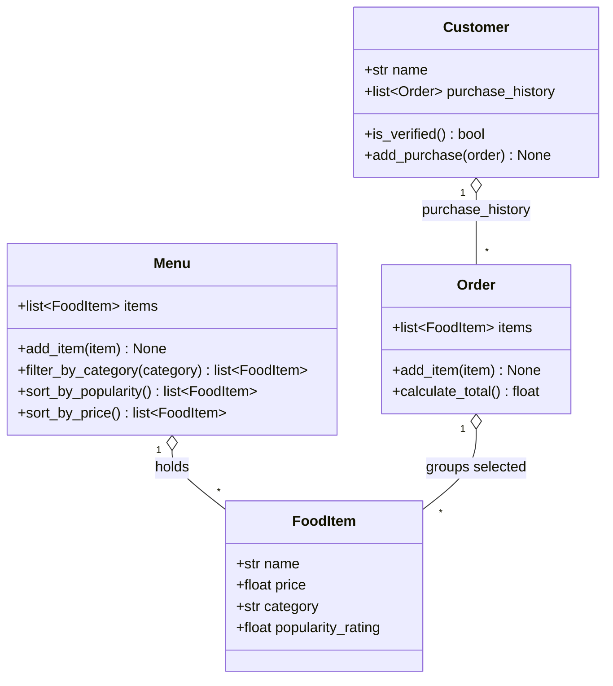

# ByteBites Design (final)

Four classes, exactly as in the spec. Every attribute and method below traces back to a sentence in `bytebites_spec.md`.

## One sentence per class

- **Customer**: a user of the app, identified by name, with a record of past orders that lets the system verify they are real.
- **FoodItem**: one sellable thing (e.g. "Spicy Burger") with a name, price, category, and popularity rating.
- **Menu**: the full collection of `FoodItem`s, able to filter by category and sort.
- **Order**: a single transaction grouping the items a user picked and computing their total cost.

## Spec traceability

| Spec sentence | Design element |
|---|---|
| "tracking their names and their past purchase history" | `Customer.name`, `Customer.purchase_history` |
| "so the system can verify they are real users" | `Customer.is_verified()` |
| "track the name, price, category, and popularity rating" | the four `FoodItem` attributes |
| "a digital list that holds all items" | `Menu.items`, `Menu.add_item()` |
| "lets us filter by category" | `Menu.filter_by_category()` |
| "store the selected items and compute the total cost" | `Order.items`, `Order.calculate_total()` |
| Activity Part 3: "filtering, sorting, and computing totals" | `Menu.sort_by_popularity()`, `Menu.sort_by_price()` |

## Design decisions

- **Category is a plain string**, not a class: the spec only ever uses it as a label to filter on.
- **Purchase history is a list of `Order`s**, not a separate class.
- **`Order` has no `customer` field**, so there is no circular reference; the customer owns the order via `purchase_history`.
- **Verification rule:** a customer is verified if they have a non-empty name and at least one past order.
- **Behaviors:** category matching ignores case; empty order totals `0`; sorts return new lists.

## What changed vs `draft_from_copilot.md`

Removed ids, email, timestamps, status, availability, `apply_discount`, `checkout`, `search`,
`update_price`, `remove_item`, `get_total_spent`, and the `Order.customer` back-reference.
Kept `is_verified()` (spec-driven) and sorting (activity-driven).
