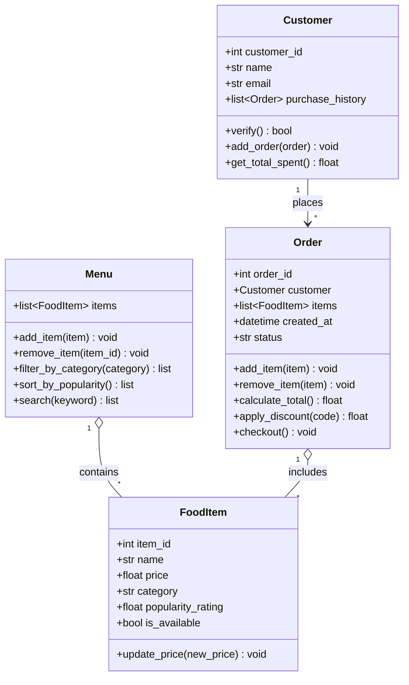

# Draft 1: standard chat, spec only (no reference file)

> Prompt: "Here is my spec (bytebites_spec.md) and my four candidate classes: Customer,
> FoodItem, Menu, Order. Generate a UML-style class diagram."
>
> Note: file name kept from the activity template. This draft was produced by Claude from
> the spec alone, with no ground rules, to compare against the guided version.

## Review against the spec

| Issue | Where | Verdict |
|---|---|---|
| Invented attributes: `customer_id`, `email`, `item_id`, `is_available`, `order_id`, `created_at`, `status` | all classes | Not in the request. Remove. |
| Invented methods: `get_total_spent`, `update_price`, `remove_item`, `search`, `apply_discount`, `checkout` | all classes | Not requested. `apply_discount` and `checkout` are real scope creep. |
| `Order.customer` back-reference | Order | Creates a circular dependency with `Customer.purchase_history`. Unneeded. |
| `verify()` | Customer | Reasonable, since the spec says history verifies real users. Keep, simplified. |
| `sort_by_popularity()` | Menu | Not stated explicitly, but the activity (Part 3) asks for sorting. Keep. |

**Takeaway:** with no guardrails the assistant added roughly 15 things the product manager
never asked for. The guided draft (`bytebites_design.md`) removes them.
